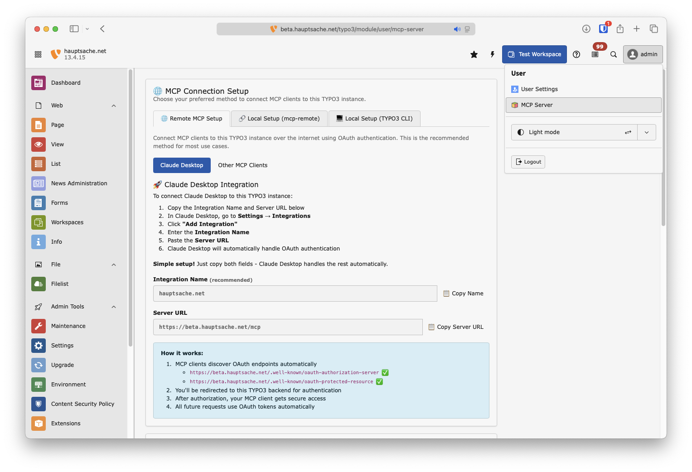

# TYPO3 MCP Server Extension

This extension provides a Model Context Protocol (MCP) server implementation for TYPO3 that allows
AI assistants to safely view and manipulate TYPO3 pages and records through TYPO3's workspace system.

## 🔒 Safe AI Content Management with Workspaces

**All content changes are automatically queued in TYPO3 workspaces**, making it completely safe for AI assistants to create, update, and modify content without immediately affecting your live website. Changes require explicit publishing to become visible to site visitors.

## 🧪 Continuously Tested With Real LLMs

Every push to `main` runs a benchmark that has the latest models from **Anthropic, OpenAI, Mistral, and Google**, plus open-weight models from **Z.ai, DeepSeek, and Qwen**, actually use this MCP to perform real TYPO3 tasks. That's how we stay vendor-independent and prove the tool descriptions convey what they claim across very different prompting styles — your AI assistant of choice should just work, not only ours. Click any badge for the full run-by-run history.

[


](https://docs.google.com/spreadsheets/d/18jL34ymMaUfoCtL32FauPu3n0cTbBTLKuVO7dmGSAS4/edit?usp=sharing)

## What Can You Do?

With the TYPO3 MCP Server, your AI assistant can help you:

### 📝 **Content Management**
- **Translate Pages**: "Translate the /about-us page to German" - The AI reads your content, translates it, and creates proper language versions
- **Import Documents**: "Create a news article from this Word document" - Transform external documents into TYPO3 content with proper structure
- **Bulk Updates**: "Update all product descriptions to include our new sustainability message" - Make consistent changes across multiple pages

### 🔍 **Content Analysis & SEO**
- **SEO Optimization**: "Add meta descriptions to all pages that don't have them" - Automatically generate missing SEO content based on page content
- **Tone Analysis**: "Review the tone of our product pages and make them more friendly" - Get suggestions for improving content voice and style
- **Content Audit**: "Find all pages mentioning our old company name" - Quickly locate content that needs updating

### 🚀 **Productivity Boosters**
- **Template Application**: "Apply our standard legal disclaimer to all service pages" - Consistently apply content patterns
- **Content Migration**: "Copy all news articles from 2023 to the archive folder" - Reorganize content efficiently
- **Multi-language Management**: "Ensure all German pages have English translations" - Identify and fill translation gaps

### 🖼️ **Images, Videos & Files**
- **Add Images From the Web**: "Put this image on our homepage: https://example.org/press/team.jpg" - The AI downloads the file into your file storage and creates the content element that shows it
- **Embed Videos**: "Put this video on the home page: https://www.youtube.com/watch?v=..." - YouTube and Vimeo links become proper TYPO3 online media assets
- **Add Text-Based Documents**: "Add this price list as a CSV download on the service page" - Text formats like SVG, CSV or subtitles can be uploaded directly as content
- **Upload From Your Machine**: "Upload the team photo from my Desktop and add it to the about page" - You get a single-use upload link, so the file goes directly to TYPO3 instead of through the AI's context

All these operations happen safely in workspaces, giving you full control to review before publishing!

> 💡 **Want to know how it works?** Check out our [Technical Overview](TECHNICAL_OVERVIEW.md) for detailed information about the implementation, available tools, and real-world examples with actual tool calls.

## Project Status

| Feature                         | Status          | Notes |
|---------------------------------|-----------------|-------|
| **MCP Connection**              | ✅ Ready         | HTTP and stdin/stdout protocols (thanks to [logiscape/mcp-sdk-php](https://github.com/logiscape/mcp-sdk-php)) |
| **Authentication**              | ✅ Ready         | OAuth for Backend Users |
| **Page Tree Navigation**        | ✅ Ready         | Page tree view similar to the TYPO3 backend |
| **Page Content Discovery**      | ✅ Ready         | Similar to the List or Page module with backend layout support |
| **Record Reading/Writing**      | ✅ Ready         | Read and write any workspace-capable TYPO3 table (core & extensions) with full schema inspection |
| **Content Translation**         | ⚠️ Experimental | Implemented, needs real-world testing |
| **File Upload**                 | ✅ Ready         | From a URL, a YouTube/Vimeo link, raw text content, or a local file via single-use upload URL. Create-only: never overwrites or deletes, identical content is detected, executable files are refused |
| **File Discovery & References** | ⚠️ Partial      | Browse `sys_file` and metadata within the user's file mounts (incl. public URLs), edit metadata, create file references. No visual or semantic image search yet |
| **Workspace Selection**         | ❌ Missing       | Currently uses the first writable workspace of the user |

While there are a lot of automated tests, TYPO3 instances are widely different and Language Models are also widely different. Feel free to [create issues here on GitHub](https://github.com/logiscape/mcp-sdk-php/issues) or [share experiences in the typo3-core-ai channel](https://typo3.slack.com/archives/C091M0M7BL6). 

## 🖼️ Files and Images

Your assistant can bring new files into TYPO3, and it picks the right of these four ways on its own:

- **From a URL**: the TYPO3 server downloads the file itself, so the file never has to pass through the AI.
- **From YouTube or Vimeo**: those links become proper TYPO3 online media assets — the video itself stays where it is.
- **Directly as content**: text-based documents like SVG, CSV or subtitle files can be uploaded as content, without a URL or a separate upload.
- **From your own computer**: the assistant hands out a single-use upload link, and your MCP client sends the file directly to TYPO3. Binary data never travels through the AI's context, which keeps large photos both cheap and private.

Uploading is deliberately **create-only** — nothing you already have can be overwritten or deleted. A name that is already taken is resolved by renaming (`image.jpg` becomes `image_01.jpg`), and uploading content that already exists returns the existing file instead of creating a duplicate. Files that could be executed, by the server or by a visitor's browser, are refused, as are files that reconfigure the web server. Downloads only work from public http(s) addresses, and your backend user's file mounts and file permissions apply throughout.

Unlike records, files are not workspace-versioned in TYPO3, so an uploaded file lands in your file storage right away. It only becomes visible on the website once a record references it — and that reference *is* workspace-staged, so the usual review before publishing still applies.

> 💡 See [Put this image on the homepage](TECHNICAL_OVERVIEW.md#put-this-image-on-the-homepage) in the Technical Overview for the actual tool calls, and [Image/File Handling](TECHNICAL_OVERVIEW.md#imagefile-handling) for the upload-token flow and the current limits.

## Installation

```bash
composer require hn/typo3-mcp-server
```

**Requirements:**
- TYPO3 v13.4+
- TYPO3 Workspaces extension (automatically installed as dependency)

### Configuration

The defaults work out of the box. All settings live in the extension configuration
(**Admin Tools → Settings → Extension Configuration → mcp_server**):

| Setting                      | Default             | Purpose |
|------------------------------|---------------------|---------|
| `maxFileSizeMb`              | `500`               | Upper limit in MiB for files fetched from a URL or received through an upload link |
| `additionalReadOnlyTables`   | `sys_file`          | Non-workspace-capable tables exposed read-only — this is what lets the AI browse your files |
| `additionalStandaloneTables` | `sys_file_metadata` | `hideTable` tables exposed as independent tables — this is what makes file metadata such as titles and alt texts editable |
| `excludedTables`             | *(empty)*           | Tables the MCP never exposes, whatever the backend user may access (admins included). A trailing `*` matches a prefix. For tables with personal data that editors still need in the backend, e.g. `tx_powermail_domain_model_mail,tx_powermail_domain_model_answer` |
| `allowedTables`              | *(empty)*           | If set, the MCP only exposes these tables (prefix `*` allowed), so tables of extensions added later stay hidden until listed. `excludedTables` wins. Empty means every table the user may access |
| `workspacePreviewLinks`      | `1`                 | Adds login-free workspace preview links to pages and records with unpublished changes, so the AI can show the result of its edits. Anyone with such a link sees all unpublished changes of the workspace until it expires |
| `oauthAccessTokenMinutes`    | `60`                | Access token lifetime for MCP clients that support refresh tokens (e.g. Claude). They renew it automatically |
| `oauthTokenHoursWithoutRefresh` | `12`             | Access token lifetime for MCP clients without refresh tokens: the user authorizes them again once per working day |
| `oauthRefreshTokenDays`      | `30`                | How long a client may stay unused before the user has to authorize it again; every refresh starts this period anew |
| `oauthMaxSessionHours`       | `0`                 | Upper limit from the authorization on, however actively a client is used; after it the user authorizes again (e.g. to pass SSO group checks). `0` = no limit |
| `manualTokenDays`            | `30`                | Lifetime of tokens created in the backend module or with `mcp:oauth create`, for tools that cannot do OAuth (e.g. n8n) |

Records other than pages and content elements (news, events, ...) get a frontend URL once
`TCEMAIN.preview.<table>` is configured in Page TSconfig — the same setting that powers the
"View" button in the backend. See [Record URLs](Documentation/Architecture/RecordUrls.md).

## Usage

### Quick Start

There are two ways to connect AI assistants like Claude Desktop to your TYPO3 installation:

#### Option 1: OAuth Authentication (Recommended)

For secure remote access with proper authentication:

1. Go to **[Username] → MCP Server** in your TYPO3 backend
2. Copy the Server URL (and optionally the Integration Name)
3. Add the Integration to whatever MCP Client you are using.



The HTTP endpoint runs with the permissions of the logged-in backend user: DB mounts, table and field permissions, and workspaces apply as in the TYPO3 backend.

MCP clients register themselves through OAuth dynamic client registration (`/mcp_oauth/register`), which needs no login. It accepts 20 registrations per IP address within 15 minutes; a client registers once or twice when a connection is set up. To change the limit, override it in `config/system/additional.php`:

```php
$GLOBALS['TYPO3_CONF_VARS']['SYS']['rateLimiter']['mcp-oauth-register'] = [
    'limit' => 50,
    'interval' => '15 minutes',
];
```

#### Option 2: Local Command Line Connection (Deprecated)

> [!WARNING]
> The stdio command is deprecated. Use the HTTP endpoint (Option 1) instead.

The stdio command always runs with admin privileges. This is intended: running it requires shell access to the server, which already means full control over the TYPO3 installation. It also only works where the MCP client can start a process on the server. To use it anyway, add this to the MCP config file of Claude Desktop or whatever client you are using:
```json
{
   "mcpServers": {
      "[your-typo3-name]": {
         "command": "php",
         "args": [
            "vendor/bin/typo3",
            "mcp:server"
         ]
      }
   }
}
```

The client keeps this process running for the whole session, while TYPO3 takes
its request time (`$GLOBALS['EXEC_TIME']`, `ACCESS_TIME`, `SIM_EXEC_TIME`,
`SIM_ACCESS_TIME` and the Context's `date` aspect) once when a process starts.
The server therefore resets the request time to the current time before every
tool call. Each call gets its own `tstamp`/`crdate`, `sys_log` and
`sys_history` time, and `starttime`/`endtime` checks use the time of the call,
as they would in a separate web request.

## Development

### Running Tests

```bash
# Functional tests (PHPUnit)
composer test

# E2E tests — spins up MySQL, TYPO3, and Playwright in Docker
Build/runTests.sh -s e2e

# E2E without Docker (host PHP + SQLite + local Playwright).
# Auto-selected when Docker is unavailable.
Build/runTests.sh -s e2e --no-docker

# E2E against an existing TYPO3 instance
TYPO3_BASE_URL=https://my.ddev.site Build/runTests.sh -s e2e

# See all options
Build/runTests.sh -h
```

### Adding New Tools

Tools are defined in the `Classes/MCP/Tool` directory. Each tool follows the MCP tool specification and maps to specific TYPO3 functionality.

## Learn More

- 📖 **[Technical Overview](TECHNICAL_OVERVIEW.md)** - Comprehensive guide covering architecture, implementation details, and advanced usage
- 🏗️ **[Architecture Documentation](Documentation/Architecture/)** - Deep dives into specific implementation aspects:
  - [Workspace Transparency](Documentation/Architecture/WorkspaceTransparency.md) - How workspace complexity is hidden from AI
  - [Language Overlays](Documentation/Architecture/LanguageOverlays.md) - Multi-language content handling
  - [Inline Relations](Documentation/Architecture/InlineRelations.md) - Managing TYPO3's complex relation types
  - [Record URLs](Documentation/Architecture/RecordUrls.md) - Frontend URLs of records and workspace preview links

## License

GPL-2.0-or-later
